<!--suppress HtmlDeprecatedAttribute -->
# Hello! 👋 I’m Muhammad Shoaib — Full Stack & Blockchain Developer

 
- 🔭 Full Stack Developer at Bitblazetec since May 2026, building production web applications with Next.js, TypeScript, FastAPI, and PostgreSQL. 
- 🎨 Developed responsive interfaces with React and Tailwind CSS, and CMS publishing workflows with Payload CMS, cache revalidation, and structured data so content teams can publish without redeploying. 
- 🛒 Made checkout safer under retries with customer-scoped idempotency keys to prevent duplicate orders and repeated stock deductions. 
- 🔐 Strengthened access control by separating customer and staff authentication, enforcing permissions at router level, and testing rejected requests with Clerk, JWT, and TOTP. 
- 🛠️ Improved reliability by saving enquiries before sending email, protecting public forms against abuse, and retrying courier tracking requests in smaller batches when invalid tracking numbers disrupted responses. 
- 🚀 Built GitHub Actions deployment pipelines with health checks and automatic rollback, and used pytest, Vitest, and Cypress to verify application behaviour. 
- ⛓️ Previously a Blockchain Developer at Kaizen Global, working on token contracts, NFT marketplaces, staking, ERC-4337 account abstraction, Diamond Proxy, multisig wallets, and confidential transactions with zk-SNARKs. 
- 🌱 Production challenges have shaped how I work: design for partial failures, make retries safe, verify third-party API behaviour, and test deployment scripts alongside application code. 

<h3 align="left">Languages and Tools:</h3>

Also in my stack: Next.js, FastAPI, SQLAlchemy, Alembic, Firebase, Zustand, Zod, Clerk, JWT, TOTP, pytest, Vitest, Cypress, testcontainers, GitHub Actions, Linux, nginx, systemd, Anchor, Ethers.js, and IPFS.

<table align="center">
  <tr>
    <td align="center" width="96">
        
       React
    </td>
    <td align="center" width="96">
        
       Python
    </td>
    <td align="center" width="96">
        
       JavaScript
    </td>
    <td align="center" width="96">
        
       TypeScript
    </td>
    <td align="center" width="96">
        
       AWS
    </td>
    <td align="center" width="96">
        
       GitHub
    </td>
  </tr>
  <tr>
    <td align="center" width="96">
        
       Git
    </td>
    <td align="center" width="96">
        
       HTML5
    </td>
    <td align="center" width="96">
        
       CSS
    </td>
    <td align="center" width="96">
        
       Tailwind
    </td>
    <td align="center" width="96">
        
       Node.js
    </td>
    <td align="center" width="96">
        
       PostgreSQL
    </td>
  </tr>
  <tr>
    <td align="center" width="96">
        
       VS Code
    </td>
    <td align="center" width="96">
        
       Docker
    </td>
    <td align="center" width="96">
        
       GraphQL
    </td>
    <td align="center" width="96">
        
       Payload CMS
    </td>
  </tr>
  <tr>
    <td align="center" width="96">
        
       Solidity
    </td>
    <td align="center" width="96">
        
       Rust
    </td>
    <td align="center" width="96">
        
       Ethereum
    </td>
    <td align="center" width="96">
        
       Solana
    </td>
    <td align="center" width="96">
        
       Hardhat
    </td>
    <td align="center" width="96">
        
       Foundry
    </td>
    <td align="center" width="96">
        
       Web3.js
    </td>
    <td align="center" width="96">
        
       Aztec
    </td>
    <td align="center" width="96">
        
       ZK
    </td>
  </tr>
  <tr>
    <td align="center" width="96">
        
       ERC-4337
    </td>
    <td align="center" width="96">
        
       Multisig
    </td>
  </tr>
</table>

 <picture>
  <source media="(prefers-color-scheme: dark)" srcset="https://raw.githubusercontent.com/Vaibhav2002/Vaibhav2002/output/github-contribution-grid-snake-dark.svg" />
  <source media="(prefers-color-scheme: light)" srcset="https://raw.githubusercontent.com/Vaibhav2002/Vaibhav2002/output/github-contribution-grid-snake.svg" />
  
</picture>

  

