### Full Stack Developer · Web Applications, APIs & Blockchain

### What I Build

I build web applications, APIs, CMS platforms, and e-commerce systems, covering frontend interfaces, backend services, and databases. I also develop smart contracts and Web3 applications on Ethereum and Solana.

### Current Focus

At **Bitblazetec**, I’m working on content publishing, checkout, authentication, and third-party integrations. My focus is secure access, safe retries, automated testing, and reliable deployments.

### Selected Experience

- **Web platforms:** Built CMS publishing and lead-management workflows, customer checkout features, and courier integrations with access controls and safe retries.
- **Blockchain:** At **Kaizen Global**, worked on token contracts, NFT marketplaces, staking, ERC-4337 account abstraction, multisig wallets, Diamond Proxy, and zk-SNARK transactions.
- **Document verification:** Led an Ethereum and IPFS academic verification platform with MetaMask authentication and role-based workflows.

### Tech stack

- **Frontend:** Next.js, React, TypeScript, JavaScript, Tailwind CSS, Zustand, Zod
- **Backend & data:** FastAPI, Python, Node.js, Express.js, Payload CMS, PostgreSQL, SQLAlchemy, Alembic, Firebase, REST APIs, GraphQL
- **Security & deployment:** Clerk, JWT, TOTP, GitHub Actions, Linux, nginx, systemd, AWS Lightsail, Docker, Git
- **Testing:** pytest, Vitest, Cypress, testcontainers, smart contract fuzz testing
- **Blockchain:** Solidity, Rust, Ethereum, Solana/Anchor, Hardhat, Foundry, Ethers.js, Web3.js, ERC-4337, zk-SNARKs, IPFS

<table align="center">
  <tr>
    <td align="center" width="96">
        
       React
    </td>
    <td align="center" width="96">
        
       Python
    </td>
    <td align="center" width="96">
        
       JavaScript
    </td>
    <td align="center" width="96">
        
       TypeScript
    </td>
    <td align="center" width="96">
        
       AWS
    </td>
    <td align="center" width="96">
        
       GitHub
    </td>
    <td align="center" width="96">
        
       Git
    </td>
    <td align="center" width="96">
        
       HTML5
    </td>
    <td align="center" width="96">
        
       CSS
    </td>
  </tr>
  <tr>
    <td align="center" width="96">
        
       Tailwind
    </td>
    <td align="center" width="96">
        
       Node.js
    </td>
    <td align="center" width="96">
        
       PostgreSQL
    </td>
    <td align="center" width="96">
        
       VS Code
    </td>
    <td align="center" width="96">
        
       Docker
    </td>
    <td align="center" width="96">
        
       GraphQL
    </td>
    <td align="center" width="96">
        
       Payload CMS
    </td>
    <td align="center" width="96">
        
       Solidity
    </td>
    <td align="center" width="96">
        
       Rust
    </td>
  </tr>
  <tr>
    <td align="center" width="96">
        
       Ethereum
    </td>
    <td align="center" width="96">
        
       Solana
    </td>
    <td align="center" width="96">
        
       Hardhat
    </td>
    <td align="center" width="96">
        
       Foundry
    </td>
    <td align="center" width="96">
        
       Web3.js
    </td>
    <td align="center" width="96">
        
       Aztec
    </td>
    <td align="center" width="96">
        
       ZK
    </td>
    <td align="center" width="96">
        
       ERC-4337
    </td>
    <td align="center" width="96">
        
       Multisig
    </td>
  </tr>
</table>

 <picture>
  <source media="(prefers-color-scheme: dark)" srcset="https://raw.githubusercontent.com/Vaibhav2002/Vaibhav2002/output/github-contribution-grid-snake-dark.svg" />
  <source media="(prefers-color-scheme: light)" srcset="https://raw.githubusercontent.com/Vaibhav2002/Vaibhav2002/output/github-contribution-grid-snake.svg" />
  
</picture>

  

---

### Contact

For full stack development opportunities and technical collaboration:

📧 [Email Me](mailto:mohammadshoaibzohaib@gmail.com)  
💼 [LinkedIn](https://www.linkedin.com/in/webm-shoaib/)  
🐙 [GitHub](https://github.com/Shoaib20455)
